

<a href="https://rehanhaider.netlify.app/"></a> 
<a href="https://rehanhaider.netlify.app/"></a><a href="https://www.linkedin.com/in/syedrehanhaider0345"></a><a href="mailto:Rehanhaider0345@gmail.com"></a><a href="https://rehanhaider.netlify.app/CV.pdf"></a> 
<a href="https://rehanhaider.netlify.app/#about"></a> 
<a href="https://rehanhaider.netlify.app/#about"></a> 
 
<a href="https://notesphere-plum.vercel.app/"></a> 
<a href="https://rehanhaider.netlify.app/#projects"></a><a href="https://github.com/rehanhaider0345/Multiple-Gaming-System"></a> 
<a href="https://github.com/rehanhaider0345/Instagram-Clone"></a><a href="https://rehanhaider.netlify.app/"></a> 
<a href="https://github.com/rehanhaider0345/?tab=repositories"></a> 
 
<a href="https://github.com/rehanhaider0345/notesphere-api"></a> 
 
 
<a href="https://github.com/rehanhaider0345/Multiple-Gaming-System"></a> 
<a href="https://github.com/rehanhaider0345/Instagram-Clone"></a> 
<a href="https://rehanhaider.netlify.app/"></a> 
<a href="mailto:Rehanhaider0345@gmail.com"></a>

