  <a href="https://rehanhaider.netlify.app/"><b>Portfolio</b></a> &nbsp;·&nbsp;
  <a href="https://www.linkedin.com/in/syedrehanhaider0345"><b>LinkedIn</b></a> &nbsp;·&nbsp;
  <a href="mailto:Rehanhaider0345@gmail.com"><b>Email</b></a> &nbsp;·&nbsp;
  <a href="https://rehanhaider.netlify.app/CV.pdf"><b>Resume</b></a>
   
  
    <a href="https://notesphere-plum.vercel.app/">NoteSphere (live)</a> ·
    <a href="https://github.com/rehanhaider0345/notesphere-frontend">frontend</a> ·
    <a href="https://github.com/rehanhaider0345/notesphere-api">api</a> ·
    <a href="https://github.com/rehanhaider0345/civic-rag-chatbot">Civic RAG Chatbot</a> ·
    <a href="https://github.com/rehanhaider0345/Multiple-Gaming-System">Gaming System</a> ·
    <a href="https://github.com/rehanhaider0345/Instagram-Clone">Instagram Clone</a> ·
    <a href="https://github.com/rehanhaider0345/PortfolioV2">Portfolio source</a>
  

