

<a href="https://rehanhaider.netlify.app/"></a> 
<a href="https://rehanhaider.netlify.app/"></a><a href="https://rehanhaider.netlify.app/CV.pdf"></a> 
<a href="https://rehanhaider.netlify.app/#about"></a> 
<a href="https://rehanhaider.netlify.app/#about"></a> 
<a href="https://rehanhaider.netlify.app/#projects"></a> 
<a href="https://notesphere-plum.vercel.app/"></a><a href="https://github.com/rehanhaider0345/civic-rag-chatbot"></a> 
<a href="https://rehanhaider.netlify.app/#projects"></a> 
<a href="https://github.com/rehanhaider0345/Instagram-Clone"></a> 
 
<a href="https://github.com/rehanhaider0345/notesphere-frontend"></a> 
<a href="https://github.com/rehanhaider0345/notesphere-api"></a> 
<a href="https://github.com/rehanhaider0345/civic-rag-chatbot"></a> 
<a href="https://github.com/rehanhaider0345/PortfolioV2"></a> 
<a href="https://github.com/rehanhaider0345/Multiple-Gaming-System"></a> 
<a href="https://github.com/rehanhaider0345/Instagram-Clone"></a> 
<a href="https://rehanhaider.netlify.app/"></a><a href="https://rehanhaider.netlify.app/"></a> 

