  

  
  
  
  
  

  

 

  

 

  
    
  

  
  
  
  
  
  
  
  
  
   
  
  
  
  

 

  
  
   
  
  
   
  
  

  🔗 NoteSphere source: <a href="https://github.com/rehanhaider0345/notesphere-frontend">frontend</a> · <a href="https://github.com/rehanhaider0345/notesphere-api">api</a> &nbsp;|&nbsp; Portfolio source: <a href="https://github.com/rehanhaider0345/PortfolioV2">PortfolioV2</a>

 

  
  

  

  

  <picture>
    <source media="(prefers-color-scheme: dark)" srcset="https://raw.githubusercontent.com/rehanhaider0345/rehanhaider0345/output/github-snake-dark.svg" />
    <source media="(prefers-color-scheme: light)" srcset="https://raw.githubusercontent.com/rehanhaider0345/rehanhaider0345/output/github-snake.svg" />
    
  </picture>

 

  <i>Open to internships, collaborations and cool project ideas. I reply fast ⚡</i>

  
  
  

